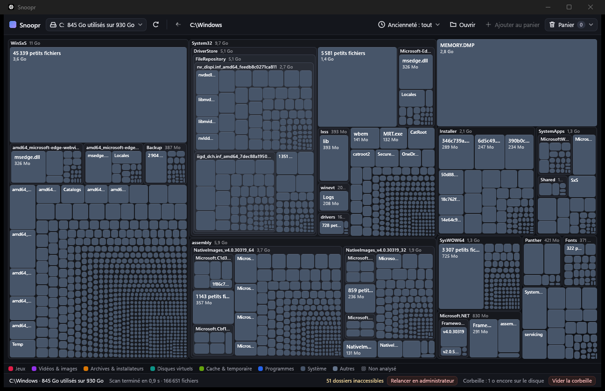

# Snoopr

Snoopr is a free, open-source disk-usage visualizer for Windows. It scans a drive and draws it as a treemap, so you can see at a glance what eats your space, then free it up safely from inside the app. It runs without administrator rights, makes no network access and has no telemetry.



## Features

- Fast multi-threaded scan, off the UI thread and cancellable. The treemap fills in while the scan runs.
- Nested-folders treemap. Double-click a folder to zoom in, Backspace to go back.
- Colours by content type: games, videos and images, archives and installers, virtual disks, cache and temporary files, programs, system, other. A legend sits above the status bar.
- Sizes are the space actually allocated on disk (NTFS compression and OneDrive online-only files count for what they really use), not logical size.
- Age filter ("what is no longer used"): files touched more recently than a threshold are greyed out, leaving only deletion candidates in colour. Age is the most recent of modified and created dates.
- Basket: add items with Del, review them, then delete in one confirmed step.
- Hover tooltip with size, share of disk, age, type and any warning.
- A "Not scanned" hatched block shows disk space that could not be read (denied folders, system-reserved space), with an optional "Restart as administrator".
- French and English interface, following the Windows language.

## Safety

Nothing is deleted without going through the confirmation window.

- Guard-rails: critical items cannot be deleted, and the button is disabled with an explanation. This covers drive roots, the Windows folder, Program Files, WindowsApps, ProgramData, `pagefile.sys`, `hiberfil.sys`, `System Volume Information`, user profile roots, `AppData` itself and its Microsoft/Packages folders, `Windows.old` and others. Rules apply to every drive.
- Warnings (deletion allowed): game launchers' folders, cloud-synced folders (the deletion also happens in the cloud), other `AppData` subfolders, `.vhdx`/`.vhd` virtual disks and Outlook `.pst`/`.ost` files.
- Recycle bin by default: "Move to Recycle Bin" is the default action. An item that cannot go to the bin is never permanently deleted silently. You get a single question to delete it permanently or skip it.
- Permanent deletion is a separate, explicit button and is irreversible. Failures are listed afterwards with a plain-language reason.
- The recycle bin appears as a block in the treemap and can only be emptied as a whole, after confirmation.

## Building

Requirements: Windows 10/11 x64 and Rust 1.85 or later (edition 2024).

```
cargo build --release
```

The executable is `target\release\snoopr-app.exe`. Tagged releases (`v*`) publish it as `snoopr.exe` through GitHub Actions.

## Running

```
snoopr.exe [path]
```

Without argument, Snoopr shows your drives, and a click starts the scan. With a path, it scans that path directly.

## En français

Snoopr est un visualiseur d'espace disque libre pour Windows : il scanne un disque et l'affiche en treemap, avec une couleur par type de contenu et un filtre d'ancienneté pour repérer ce qui ne sert plus.
On ajoute des éléments au panier, puis on les supprime après confirmation, par défaut vers la corbeille.
Des garde-fous bloquent la suppression des éléments système (Windows, Program Files, pagefile.sys, profils...) et avertissent pour les jeux, dossiers cloud et disques virtuels.
Aucune suppression définitive silencieuse, aucun droit administrateur requis, aucun accès réseau.
L'interface suit la langue de Windows (français ou anglais). Compilation : `cargo build --release`. Lancement : `snoopr.exe [chemin]`.

## Licence

Dual-licensed under MIT OR Apache-2.0, at your option. See `LICENSE-MIT` and `LICENSE-APACHE`.
